<div align="center">


<h1>LumenPitch</h1>

<h3><b>The Open-Source AI Presentation Studio &amp; Multi-LLM Deck Engine</b></h3>

<p><i>From raw ideas, documents, and web research to executive-grade slide decks — powered by your choice of Local AI or Cloud LLMs.</i></p>

<p>
  <a href="https://annoris.github.io/lumenpitch/"></a>
  <a href="https://github.com/annoris/lumenpitch/stargazers"></a>
  <a href="SOURCE_ACCESS.md"></a>
  <a href="SOURCE_ACCESS.md"></a>
  <a href="SOURCE_ACCESS.md"></a>
  <a href="SOURCE_ACCESS.md"></a>
  <a href="SOURCE_ACCESS.md"></a>
  <a href="#supported-ai-providers--ecosystem"></a>
  <a href="PAYMENT.md"></a>
  <a href="LICENSE"></a>
</p>

<p align="center">
  <a href="https://annoris.github.io/lumenpitch/"><b>🚀 Launch Live Interactive Studio</b></a> •
  <a href="SOURCE_ACCESS.md"><b>🔓 Unlock Full Source Vault (<code>annoris/lumenpitch-pro-source</code>)</b></a> •
  <a href="#why-lumenpitch">Why LumenPitch?</a> •
  <a href="#visual-showcase--platform-tour">Visual Tour</a> •
  <a href="#16-bundled-studio-templates-gallery">16 Templates</a> •
  <a href="#architecture--tech-stack">Architecture</a> •
  <a href="#support--crypto-sponsorship-solana">Solana Support</a>
</p>

<hr />

<p align="center">
  <a href="https://annoris.github.io/lumenpitch/">
    
  </a>
</p>

<a href="https://annoris.github.io/lumenpitch/">
  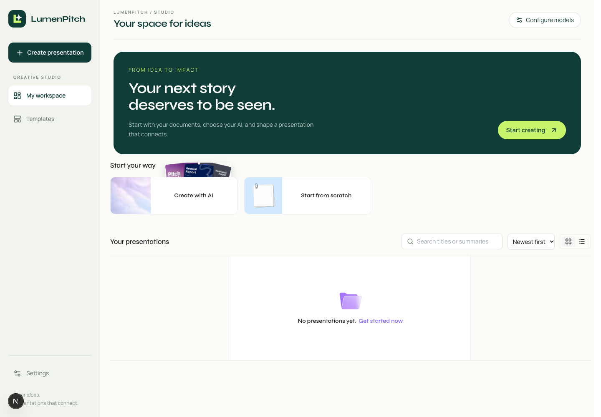
</a>

<br />

<table>
  <tr>
    <td align="center" width="33%">
      <a href="https://annoris.github.io/lumenpitch/">
        
      </a>
      <br />
      <b>1. Creative Studio Workspace</b><br />
      <sub>PDF/DOCX/PPTX ingestion, live web grounding &amp; instant deck library</sub>
    </td>
    <td align="center" width="33%">
      <a href="https://annoris.github.io/lumenpitch/">
        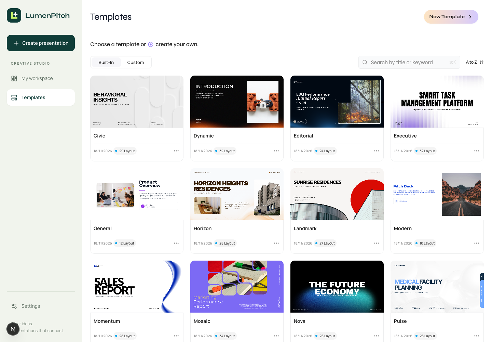
      </a>
      <br />
      <b>2. 16 Studio Design Systems (400+ Layouts)</b><br />
      <sub>Built-in certified themes + Custom <code>.pptx</code> Vision V2 Compiler</sub>
    </td>
    <td align="center" width="33%">
      <a href="https://annoris.github.io/lumenpitch/">
        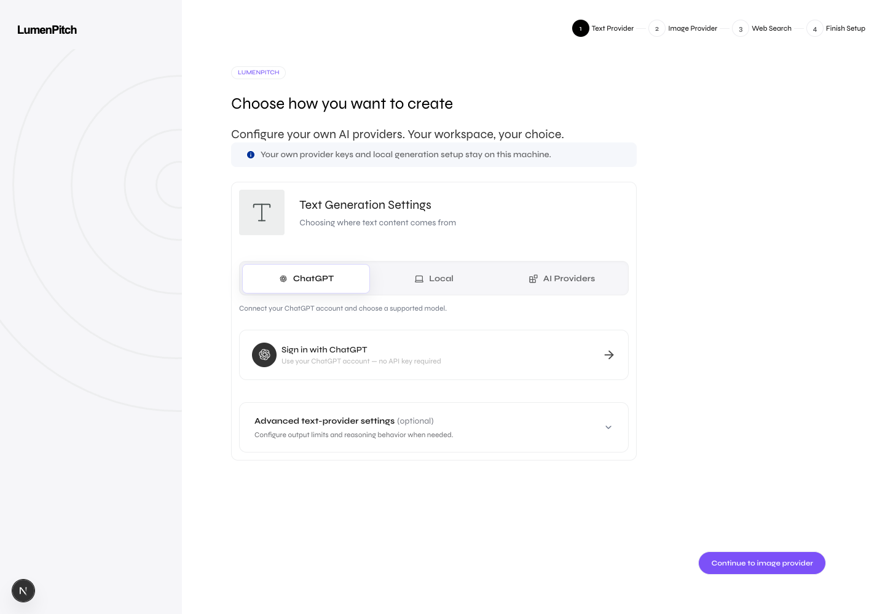
      </a>
      <br />
      <b>3. 4-Step AI Provider Setup Wizard</b><br />
      <sub>16+ Local &amp; Cloud LLMs (Ollama, OpenAI, Claude, Gemini, ComfyUI, SearXNG)</sub>
    </td>
  </tr>
</table>

</div>

---

## Why LumenPitch?

Most AI presentation builders lock your sensitive documents inside proprietary clouds, force you into rigid cookie-cutter layouts, and charge recurring per-seat subscriptions on top of marked-up token costs.

**LumenPitch** flips the paradigm. It is a self-hosted, privacy-first **AI Presentation Studio** combining a modern **Next.js 16** slide editor, a high-concurrency **FastAPI + SQLModel** generation engine, a **Template V2 Vision compiler** that turns any `.pptx` into reusable schema-validated layouts, and a native **Electron** desktop runtime.

| Capability | Cloud SaaS Slide Tools | Generic Markdown-to-Slide Scripts | **LumenPitch Studio** |
| :--- | :--- | :--- | :--- |
| **Data & Document Privacy** | Uploaded to 3rd-party multi-tenant cloud | Local, but no document parsing pipeline | **100% Self-Hosted** (Local SQLite/DB + LiteParse OCR/PDF ingestion) |
| **LLM Freedom (BYOK & Local)** | Locked to vendor's default model | Limited API hooks | **16+ Providers**: Ollama, LM Studio, OpenAI, Claude, Gemini, Bedrock, DeepSeek, OpenRouter, vLLM |
| **Generation Modes** | Single rigid flow | Static Markdown | **Dual Engine**: **Standard Mode** (outline review + certified layouts) & **Smart Mode** (real-time streaming adaptive UI) |
| **Custom `.pptx` Ingestion** | Manual recreation required | Not supported | **Template V2 Vision Pipeline**: Multi-pass VLM compiler converts real PPTX decks into structured, editable layouts |
| **Image & Asset Pipeline** | Paid credits required | Manual image links | **ComfyUI, OpenAI, Gemini, Open WebUI, Pexels, Pixabay** + automated icon hydration |
| **Live Web Grounding** | Often paywalled | None | **SearXNG (Self-Hosted), Tavily, Exa, Brave Search, Serper** |
| **Agent Integration (MCP)** | Closed ecosystem | None | **Built-in Model Context Protocol (MCP) Server** exposing generation tools to AI agents |

---

## Visual Showcase & Platform Tour

> [!NOTE]
> All screenshots below are captured directly from a real, authenticated local LumenPitch installation (`1440×1000` viewport). Empty libraries and unconfigured provider states reflect a clean out-of-the-box setup with zero fabricated company data or hardcoded keys.

### 1. The Creative Studio Workspace (`My Workspace`)


The **LumenPitch Creative Studio** (`servers/nextjs/app/(presentation-generator)/dashboard`) serves as your central command center:
- **Hero Launchpad ("From Idea to Impact"):** Jump straight into presentation creation with document uploads (PDF, DOCX, PPTX, TXT via `@llamaindex/liteparse`), custom instructions, slide count controls, and live web-grounding toggles.
- **Dual Creation Entry Points:**
  - **Create with AI:** Launch the guided LLM pipeline (outline generation, template pairing, and schema-driven slide hydration).
  - **Start from Scratch:** Open the interactive canvas editor immediately using any certified layout.
- **Presentation Library & Instant Search:** Filter decks by title or summary, sort chronologically, and toggle between visual grid cards and compact executive list views.
- **Zero-Barrier Exploration:** Browse the workspace and inspect all built-in templates before configuring a single AI provider key.

<table>
  <tr>
    <td align="center" width="33%">
      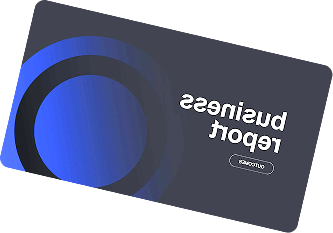
      <br />
      <sub><b>Pitch Decks & GTM Strategy</b></sub>
    </td>
    <td align="center" width="33%">
      
      <br />
      <sub><b>Annual & Financial Reports</b></sub>
    </td>
    <td align="center" width="33%">
      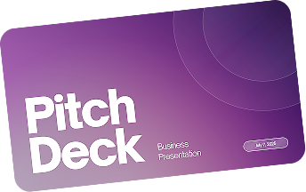
      <br />
      <sub><b>Executive Business Reviews</b></sub>
    </td>
  </tr>
</table>

---

### 2. Multi-Layout Template Library & Custom Template V2 Studio


The **Template Library** (`servers/nextjs/app/(presentation-generator)/templates`) manages both **Built-In** studio systems and **Custom Template V2** designs imported from your own PowerPoint files:
- **16 Production-Ready Design Systems:** Over **400+ individual certified slide layouts** spanning 16 distinct visual themes (from *Civic* with 29 layouts and *Mosaic* with 34 layouts to *Dynamic* and *Executive* with 32 layouts each).
- **Instant Filtering & Inspection:** Search by title or keyword (`⌘K`), inspect layout counts, and preview typography and color roles before generating.
- **Custom `.pptx` to Template V2 Compiler (`New Template`):** Upload any existing corporate `.pptx` deck along with custom brand fonts. LumenPitch renders slide previews and runs four parallel vision-model passes—detecting charts/tables/gauges, classifying semantic components, identifying repeatable card grids, and calculating safe text capacity—to compile a reusable, schema-validated template.

---

### 3. Privacy-First AI Provider Setup & Local Model Orchestration


The **4-Step Provider Setup Wizard** (`Text Provider` → `Image Provider` → `Web Search` → `Finish Setup`) gives you total control over where your data and inference run:
1. **Text Generation Settings:**
   - **ChatGPT / Codex OAuth:** Sign in directly with your ChatGPT account on `localhost:1455` without managing API keys.
   - **Local Inference:** Run 100% offline or on-premise with **Ollama**, **LM Studio**, **LiteLLM**, or any **OpenAI-compatible** local server (vLLM, llama.cpp).
   - **Cloud AI Providers:** Native integrations for **OpenAI**, **Anthropic Claude**, **Google Gemini**, **Vertex AI**, **AWS Bedrock**, **Azure OpenAI**, **DeepSeek**, **OpenRouter**, **Fireworks**, **Together AI**, and **Cerebras**.
   - **Advanced Reasoning Controls:** Fine-tune max output tokens, extended reasoning modes, thinking budgets, and OpenRouter zero-data-retention (`OPENROUTER_ZDR`) policies.
2. **Image & Visual Asset Providers:** Connect **ComfyUI** (custom local JSON workflows), **OpenAI GPT-Image**, **Google Gemini**, **Open WebUI**, **Pexels**, or **Pixabay** with parallel image generation (`ENABLE_PARALLEL_IMAGE_GENERATION=true`).
3. **Web Grounding & Search Engines:** Ground slide facts in real-time web citations using self-hosted **SearXNG**, **Tavily**, **Exa**, **Brave Search**, or **Serper**.

---

### 4. Dual Presentation Generation Modes: `Standard` vs. `Smart`

LumenPitch supports two distinct generation pipelines, configurable globally via `PRESENTATION_GENERATION_MODE=both|standard|smart` (see [`docs/presentation-generation-modes.md`](./docs/presentation-generation-modes.md)):

<table>
  <tr>
    <td align="center" width="50%">
      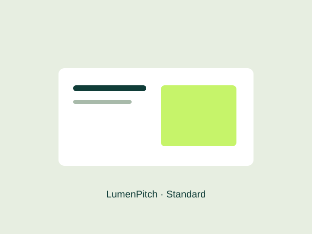
      <br />
      <b>Standard Mode (Outline + Certified Templates)</b>
      <p align="left">
        <sub>Uses predefined, certified <code>1280×720</code> layouts for predictable brand compliance. Includes an interactive <b>Outline Review & Reordering</b> step, pairs each slide with the optimal layout schema from any Built-In or Custom V2 template, and hydrates text, charts, tables, and icons with strict geometry validation.</sub>
      </p>
    </td>
    <td align="center" width="50%">
      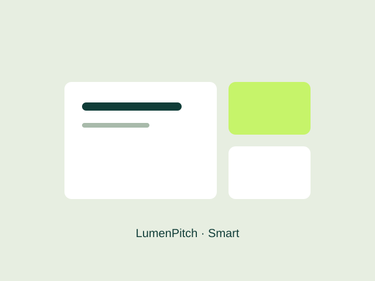
      <br />
      <b>Smart Mode (Adaptive Real-Time Streaming)</b>
      <p align="left">
        <sub>Uses adaptive, content-responsive layouts that stream directly into the slide editor via Server-Sent Events (SSE). Ideal for rapid brainstorming, dynamic data storytelling, and zero-friction drafting without selecting a fixed template upfront.</sub>
      </p>
    </td>
  </tr>
</table>

---

## 16 Bundled Studio Templates Gallery

Every installation of LumenPitch ships with **16 curated presentation systems** stored in `templates/` ([Private Source Vault](./SOURCE_ACCESS.md)). Each template includes dozens of specialized slide layouts (cover slides, KPI dashboards, comparison matrices, timelines, data charts, and executive summaries):

<table>
  <tr>
    <td align="center" width="25%">
      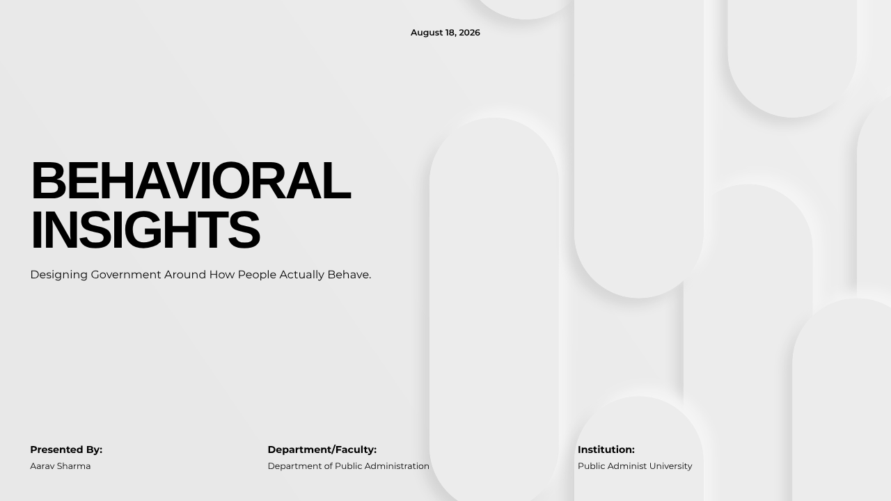
      <br />
      <b>Civic</b> · <sub>29 Layouts</sub>
      <br />
      <sub>Policy, research & behavioral insights</sub>
    </td>
    <td align="center" width="25%">
      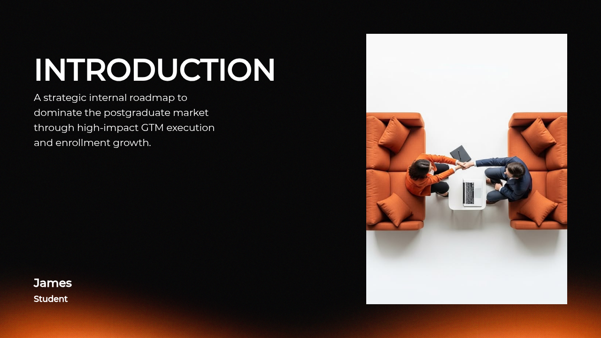
      <br />
      <b>Dynamic</b> · <sub>32 Layouts</sub>
      <br />
      <sub>High-contrast GTM & strategic roadmaps</sub>
    </td>
    <td align="center" width="25%">
      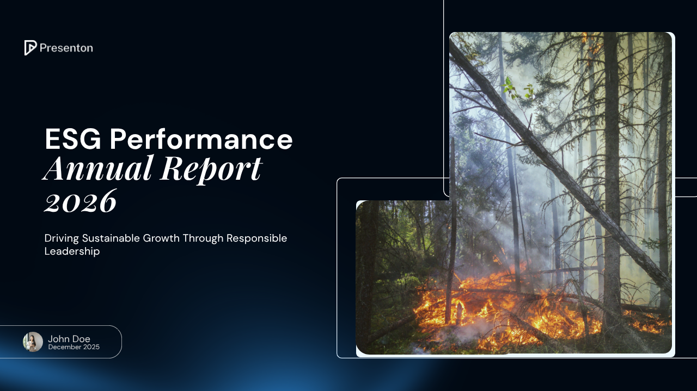
      <br />
      <b>Editorial</b> · <sub>24 Layouts</sub>
      <br />
      <sub>Annual reports, ESG & executive publications</sub>
    </td>
    <td align="center" width="25%">
      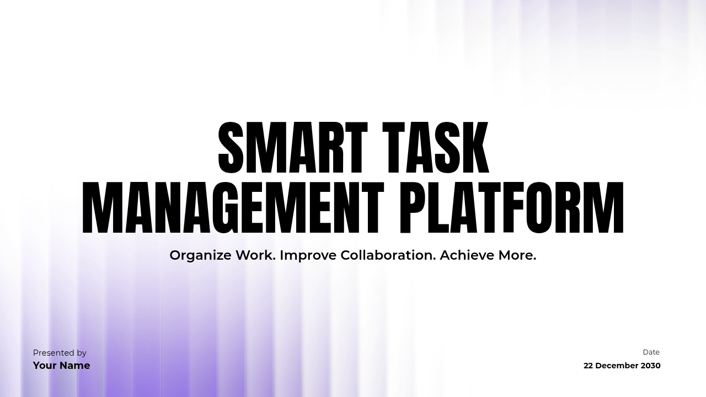
      <br />
      <b>Executive</b> · <sub>32 Layouts</sub>
      <br />
      <sub>SaaS platforms, product launches & board decks</sub>
    </td>
  </tr>
  <tr>
    <td align="center" width="25%">
      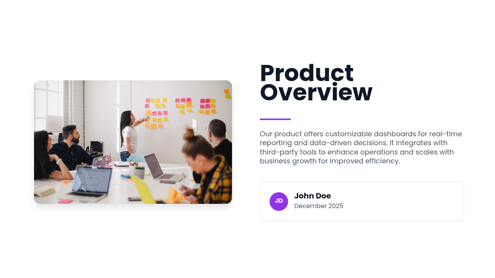
      <br />
      <b>General</b> · <sub>12 Layouts</sub>
      <br />
      <sub>Clean all-purpose product & team overviews</sub>
    </td>
    <td align="center" width="25%">
      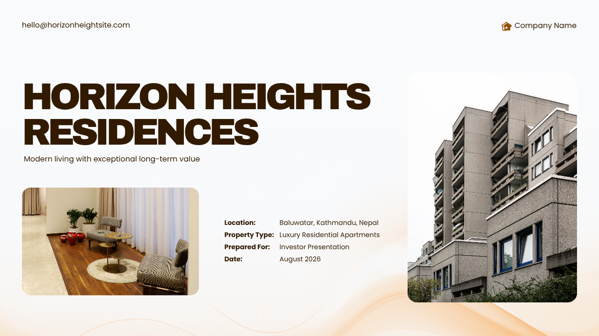
      <br />
      <b>Horizon</b> · <sub>28 Layouts</sub>
      <br />
      <sub>warm architectural & portfolio showcases</sub>
    </td>
    <td align="center" width="25%">
      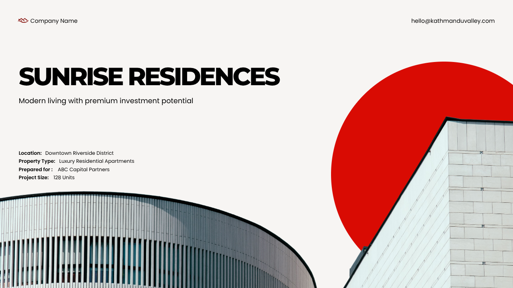
      <br />
      <b>Landmark</b> · <sub>27 Layouts</sub>
      <br />
      <sub>Bold geometric layouts for capital & enterprise</sub>
    </td>
    <td align="center" width="25%">
      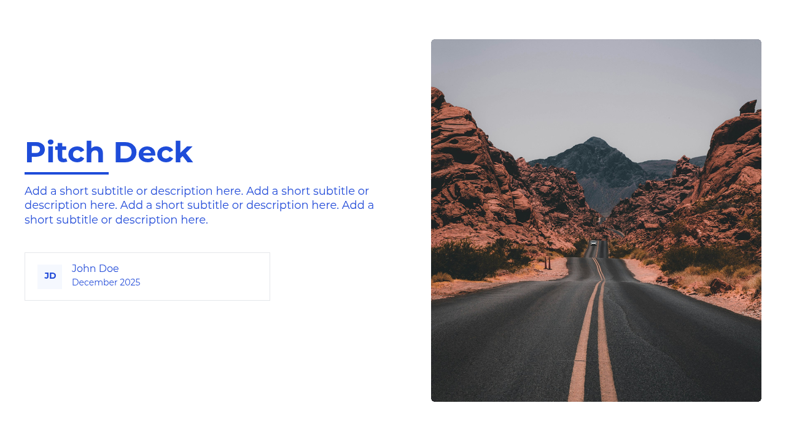
      <br />
      <b>Modern</b> · <sub>10 Layouts</sub>
      <br />
      <sub>Crisp blue-accented startup pitch decks</sub>
    </td>
  </tr>
  <tr>
    <td align="center" width="25%">
      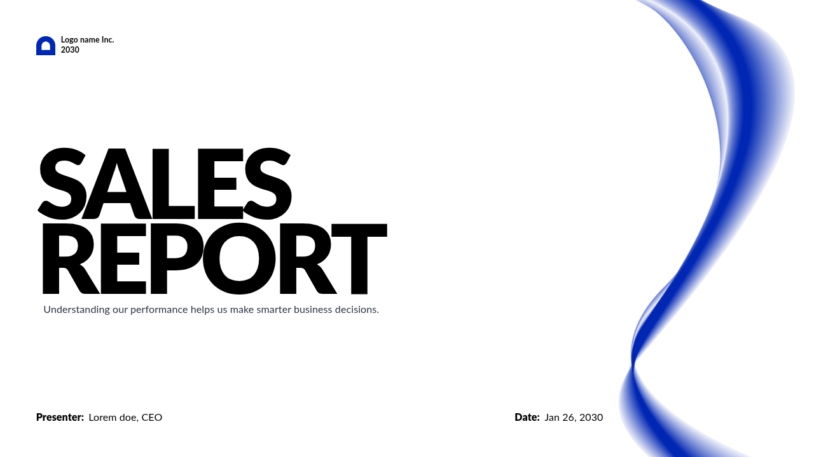
      <br />
      <b>Momentum</b> · <sub>28 Layouts</sub>
      <br />
      <sub>Revenue velocity, QBRs & sales reports</sub>
    </td>
    <td align="center" width="25%">
      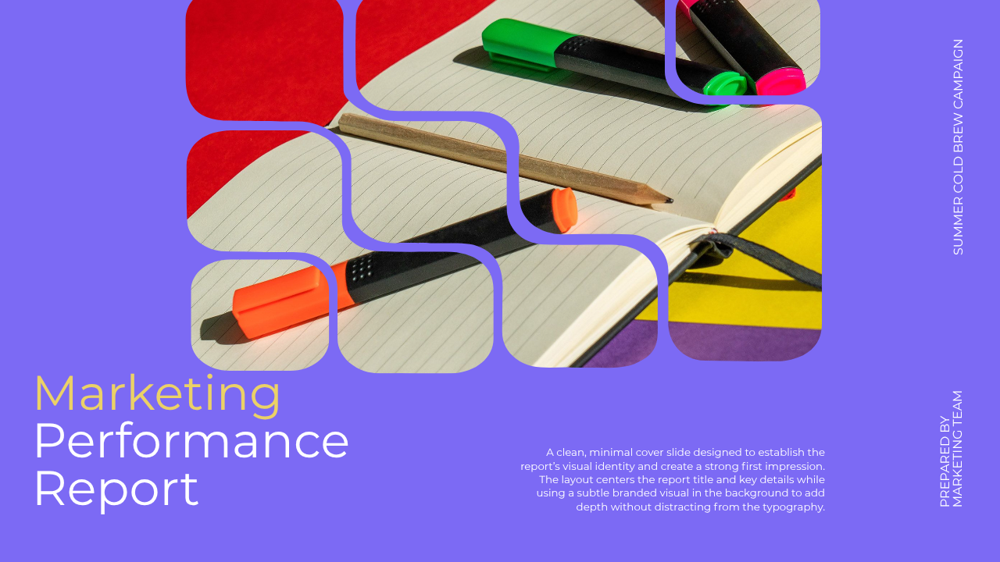
      <br />
      <b>Mosaic</b> · <sub>34 Layouts</sub>
      <br />
      <sub>Creative campaigns & marketing performance</sub>
    </td>
    <td align="center" width="25%">
      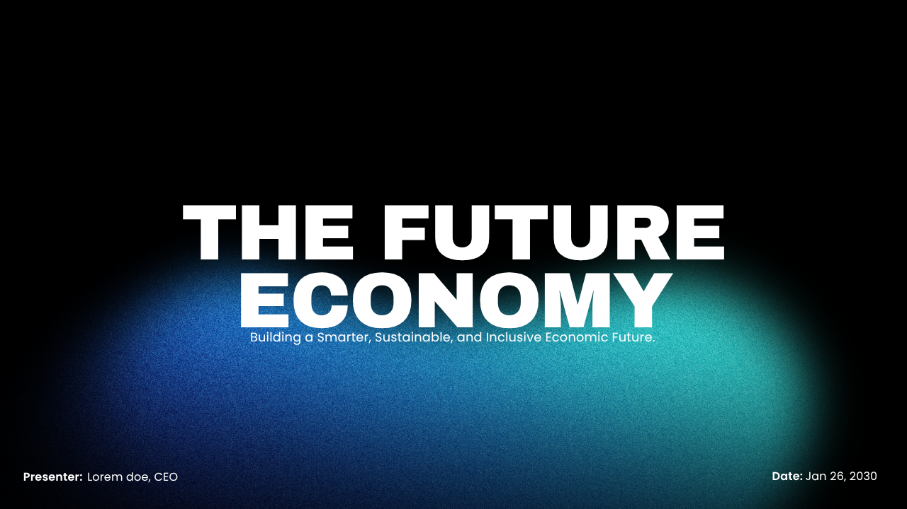
      <br />
      <b>Nova</b> · <sub>28 Layouts</sub>
      <br />
      <sub>Deep-tech, macro trends & future economy</sub>
    </td>
    <td align="center" width="25%">
      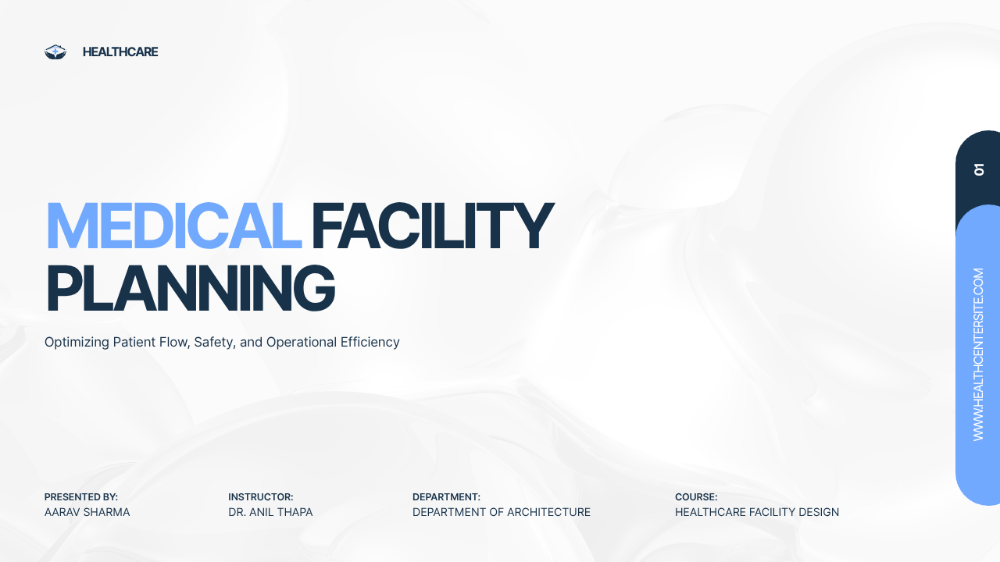
      <br />
      <b>Pulse</b> · <sub>28 Layouts</sub>
      <br />
      <sub>Healthcare, clinical operations & planning</sub>
    </td>
  </tr>
  <tr>
    <td align="center" width="25%">
      
      <br />
      <b>Signal</b> · <sub>28+ Layouts</sub>
      <br />
      <sub>Digital growth, agency briefs & media</sub>
    </td>
    <td align="center" width="25%">
      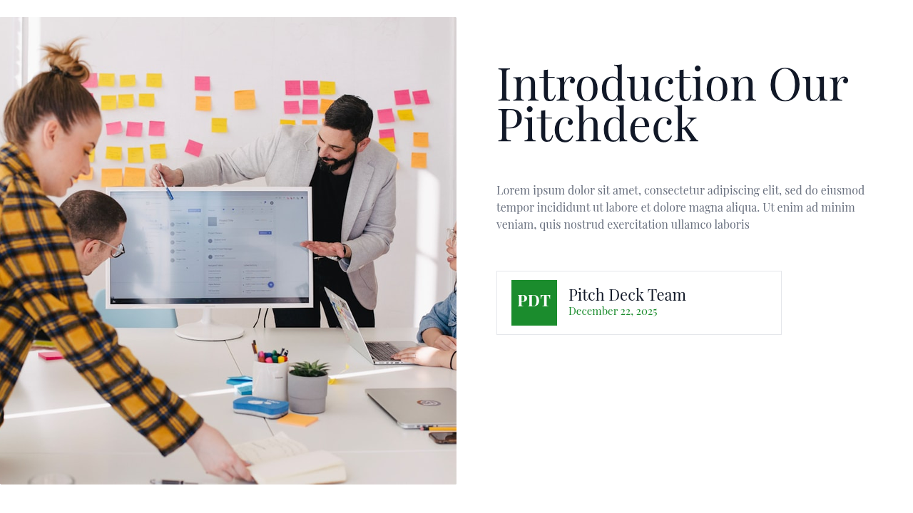
      <br />
      <b>Standard</b> · <sub>Classic Layouts</sub>
      <br />
      <sub>Editorial serif typography for formal pitches</sub>
    </td>
    <td align="center" width="25%">
      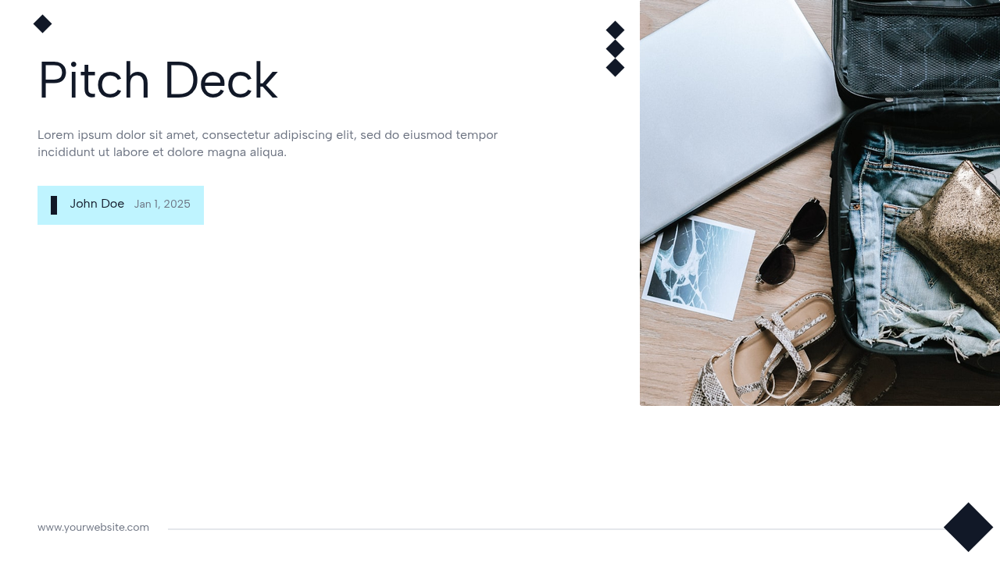
      <br />
      <b>Swift</b> · <sub>Minimal Layouts</sub>
      <br />
      <sub>Lightweight minimalist slides for fast briefings</sub>
    </td>
    <td align="center" width="25%">
      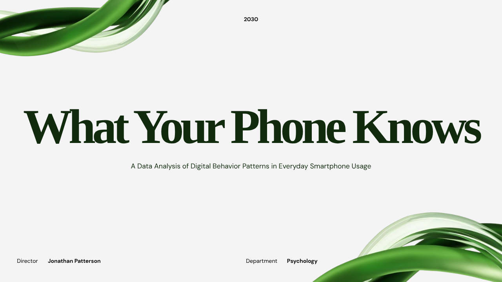
      <br />
      <b>Verdant</b> · <sub>Data & Research</sub>
      <br />
      <sub>Organic emerald aesthetics for data storytelling</sub>
    </td>
  </tr>
</table>

---

## Supported AI Providers & Ecosystem

LumenPitch natively integrates with the leading open-source and commercial AI infrastructure. All provider icons below live in [`servers/nextjs/public/providers/`](./servers/nextjs/public/providers):

<table>
  <tr>
    <td align="center" width="12.5%">
      <br /><sub><b>Ollama</b></sub>
    </td>
    <td align="center" width="12.5%">
      <br /><sub><b>LM Studio</b></sub>
    </td>
    <td align="center" width="12.5%">
      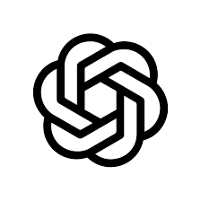<br /><sub><b>OpenAI</b></sub>
    </td>
    <td align="center" width="12.5%">
      <br /><sub><b>Claude</b></sub>
    </td>
    <td align="center" width="12.5%">
      <br /><sub><b>Gemini</b></sub>
    </td>
    <td align="center" width="12.5%">
      <br /><sub><b>DeepSeek</b></sub>
    </td>
    <td align="center" width="12.5%">
      <br /><sub><b>OpenRouter</b></sub>
    </td>
    <td align="center" width="12.5%">
      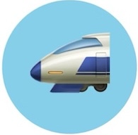<br /><sub><b>LiteLLM</b></sub>
    </td>
  </tr>
  <tr>
    <td align="center" width="12.5%">
      <br /><sub><b>Bedrock</b></sub>
    </td>
    <td align="center" width="12.5%">
      <br /><sub><b>Azure AI</b></sub>
    </td>
    <td align="center" width="12.5%">
      <br /><sub><b>Vertex AI</b></sub>
    </td>
    <td align="center" width="12.5%">
      <br /><sub><b>Fireworks</b></sub>
    </td>
    <td align="center" width="12.5%">
      <br /><sub><b>Together</b></sub>
    </td>
    <td align="center" width="12.5%">
      <br /><sub><b>Cerebras</b></sub>
    </td>
    <td align="center" width="12.5%">
      <br /><sub><b>ComfyUI</b></sub>
    </td>
    <td align="center" width="12.5%">
      <br /><sub><b>SearXNG</b></sub>
    </td>
  </tr>
</table>

---

## Architecture & Tech Stack

LumenPitch is architected as a decoupled, multi-target platform that runs identically inside a single unified Docker container (via Nginx + `start.js`), a local multi-process developer environment, or a packaged **Electron** desktop app.

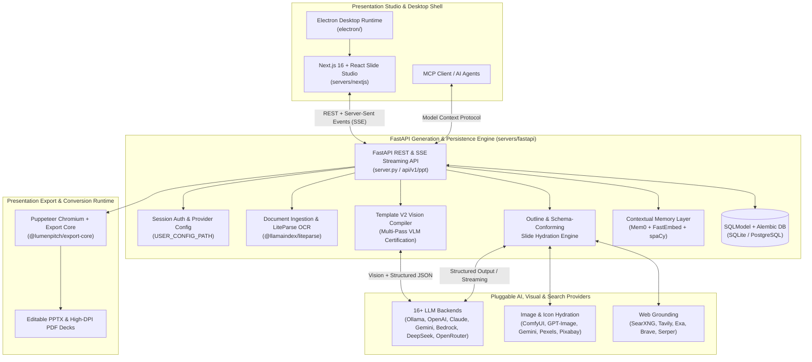

### Component Breakdown

| Directory ([Private Source Vault](./SOURCE_ACCESS.md)) | Responsibility | Key Technologies |
| :--- | :--- | :--- |
| `servers/nextjs/` ([Unlock Source](./SOURCE_ACCESS.md)) | Web application, interactive slide canvas editor, Template V2 visual studio, provider onboarding wizard, and export triggers | Next.js `16.4.6`, React, TypeScript, Tailwind CSS, Redux Toolkit |
| `servers/fastapi/` ([Unlock Source](./SOURCE_ACCESS.md)) | REST & SSE streaming API, multi-LLM orchestration, Template V2 vision certification, Mem0 memory, MCP server, and persistence | Python `3.11`, FastAPI, SQLModel, Alembic, LiteLLM, Pydantic |
| `electron/` ([Unlock Source](./SOURCE_ACCESS.md)) | Cross-platform desktop packaging, lifecycle management, local process supervision, and IPC security boundaries | Electron, TypeScript, Electron Builder |
| `templates/` ([Unlock Source](./SOURCE_ACCESS.md)) | 16 bundled presentation template systems with certified slide layouts, static thumbnails, and vector assets | JSON Layout Schemas, SVG/PNG Assets |
| `scripts/` ([Unlock Source](./SOURCE_ACCESS.md)) | Template conversion utilities, export runtime synchronization (`sync-presentation-export.cjs`), and read-only diagnostics (`project-health.mjs`) | Node.js ESM/CJS, Python |
| [`docs/`](./docs/) | Architectural specifications, Template V2 deep dive, generation modes guide, k6 load-testing telemetry, and validation reports | Markdown, Mermaid Diagrams |

### Deep-Dive Documentation

- **[`SOURCE_ACCESS.md`](./SOURCE_ACCESS.md)** — 3-step guide to unlock the private `annoris/lumenpitch-pro-source` repository via Solana (`3HvUMCUSSHEdtA35UuD4J7mbgpTxJ7LgT2X7GfdzvBdm`).
- **[`PAYMENT.md`](./PAYMENT.md)** — Commercial white-label licensing tiers, QR code, and Solana verification instructions.
- **[`SPONSORS.md`](./SPONSORS.md)** — Hall of Patrons and institutional sponsors.
- **[`docs/ARCHITECTURE.md`](./docs/ARCHITECTURE.md)** — Core component boundaries, runtime contract, and verification commands.
- **[`docs/PROJECT_STRUCTURE.md`](./docs/PROJECT_STRUCTURE.md)** — Repository folder map and contributor workflow rules.
- **[`docs/template-v2.md`](./docs/template-v2.md)** — End-to-end architecture of the **Template V2 Vision Compiler** (how source `.pptx` decks and slide screenshots are analyzed in parallel to produce certified, schema-validated `1280×720` layouts).
- **[`docs/presentation-generation-modes.md`](./docs/presentation-generation-modes.md)** — Complete guide to configuring `PRESENTATION_GENERATION_MODE` (`both`, `standard`, `smart`) across Docker, source deployments, and the MCP server.
- **[`docs/amazon-bedrock.md`](./docs/amazon-bedrock.md)** — Enterprise configuration guide for AWS Bedrock authentication and model selection.
- **[`docs/lumenpitch-resource-usage.md`](./docs/lumenpitch-resource-usage.md)** — 51-minute controlled **k6 concurrency & resource telemetry report** (16 complete 10–40 slide generation workflows across 4 concurrent virtual user waves with `0.00%` HTTP failure rate).
- **[`docs/VALIDATION.md`](./docs/VALIDATION.md)** — Real test execution results (164 Next.js tests, 47 root converter/security tests, 40 FastAPI configuration tests, 14 Electron security tests).

---

## Installation & Verified Contributor Access Gate (Solana Pay)

> [!IMPORTANT]
> **Solana-Gated Sponsorware Architecture (`annoris/lumenpitch-pro-source`):**
> - **Interactive Live Web & Mobile App Studio:** Explore the studio UI right now at **[https://annoris.github.io/lumenpitch/](https://annoris.github.io/lumenpitch/)**
> - **Full Editable Full-Stack Source Vault (`annoris/lumenpitch-pro-source`):** The complete, unminified full-stack platform (`servers/nextjs/`, `servers/fastapi/`, `electron/`, `templates/`, `scripts/`, `Dockerfile`, and `docker-compose.yml`) is hosted inside the private repository **`annoris/lumenpitch-pro-source`**.
> - **How to Unlock Full Clone & Download Access:**
>   1. Send your contribution in **SOL** or **USDC-SPL** (**$75 – $149 USD** Individual Unlock / **$450 USD** Studio License / **$1,500 USD** Enterprise License) on Solana Mainnet to **`3HvUMCUSSHEdtA35UuD4J7mbgpTxJ7LgT2X7GfdzvBdm`**.
>   2. Submit your transaction signature (`txSig`) in a **[🔓 Solana Source Code Unlock Request](https://github.com/annoris/lumenpitch/issues/new?template=source_unlock_request.md)** (or [Release Access Claim Issue](https://github.com/annoris/lumenpitch/issues/new?template=claim-release-access.yml)).
>   3. Your GitHub account will receive a collaborator invitation to **`https://github.com/annoris/lumenpitch-pro-source`**. See [`SOURCE_ACCESS.md`](./SOURCE_ACCESS.md) and [`PAYMENT.md`](./PAYMENT.md).

### Prerequisites (Once Your GitHub Account Is Verified & Invited)

- **Node.js** `22.12+` & **npm**
- **Python** `3.11` & **[uv](https://github.com/astral-sh/uv)** (fast Python package & lockfile manager)

### Option 1: Local Multi-Process Development (For Verified Contributors)

1. **Clone the private source vault (`annoris/lumenpitch-pro-source`) and initialize your environment file:**
   ```bash
   git clone https://github.com/annoris/lumenpitch-pro-source.git
   cd lumenpitch-pro-source
   cp .env.example .env
   ```

2. **Install root dependencies and run the read-only project diagnostics check:**
   ```bash
   npm ci
   npm run doctor
   ```

3. **Start the FastAPI backend engine (`port 8000`):**
   ```bash
   cd servers/fastapi
   uv sync --locked --dev
   uv run python server.py --port 8000
   ```

4. **In a second terminal, start the Next.js studio interface (`port 3000`):**
   ```bash
   cd servers/nextjs
   npm ci
   npm run dev
   ```

5. **Open [http://localhost:3000](http://localhost:3000)** in your browser, create your local administrator account, and configure your preferred AI provider (or browse the workspace and 16 templates immediately).

---

### Option 2: Docker Compose Deployment

LumenPitch includes production and development profiles in `docker-compose.yml` ([Private Source Vault](./SOURCE_ACCESS.md), with optional NVIDIA GPU passthrough via `production-gpu` and `development-gpu`).

```bash
# 1. Configure your environment variables in .env
cp .env.example .env

# 2. Launch the production service on http://localhost:5001
docker compose up --build production
```

> [!IMPORTANT]
> **Export Engine Contract (`@lumenpitch/export-core`):**
> Exports and conversions require a compatible external export archive authorized by the operator. No proprietary export binary is bundled or downloaded from an unverified third party by default.
> - For local builds, synchronize an authorized `.tgz` archive:
>   ```bash
>   EXPORT_CORE_ARCHIVE=/authorized/path/export-core.tgz npm run sync:presentation-export
>   npm run check:presentation-export
>   ```
> - For Docker builds, set `EXPORT_CORE_DOWNLOAD_BASE` to an authorized release server you control, or provide the archive via a BuildKit secret.

---

### Environment Configuration Reference (`.env`)

All runtime storage paths (`APP_DATA_DIRECTORY`, `TEMP_DIRECTORY`, `USER_CONFIG_PATH`, and `DATABASE_URL`) are kept outside the Git working tree:

```dotenv
# Core Paths & Persistence
APP_DATA_DIRECTORY=/tmp/lumenpitch-data
TEMP_DIRECTORY=/tmp/lumenpitch-temp
USER_CONFIG_PATH=/tmp/lumenpitch-data/userConfig.json
DATABASE_URL=sqlite+aiosqlite:////tmp/lumenpitch-data/lumenpitch.db

# Application Endpoints & Mode
NEXT_PUBLIC_APP_NAME=LumenPitch
NEXT_PUBLIC_FAST_API=http://localhost:8000
NEXT_PUBLIC_URL=http://localhost:3000
PRESENTATION_GENERATION_MODE=both   # Options: both | standard | smart
```

---

### Verification & Health Checks

Run the built-in test suites and read-only diagnostics at any time:

```bash
# 1. Read-only structural & toolchain health check
npm run doctor

# 2. Root template-converter, security & metadata tests (47 tests)
npm test

# 3. Next.js frontend unit tests, typecheck & production build (164 tests)
cd servers/nextjs
npm test
npx tsc --noEmit
npm run build

# 4. FastAPI backend test suite (Python 3.11)
cd ../fastapi
uv sync --locked --dev
uv run --locked python -m pytest

# 5. Electron desktop typecheck & security boundary tests (14 tests)
cd ../../electron
npm run typecheck
npm run test:security
```

---

## Support & Crypto Sponsorship (Solana)

### Sponsor Open-Source Development or Unlock Pre-Built Release Access via Solana

Building and maintaining an enterprise-grade, multi-LLM AI presentation studio requires continuous engineering across vision pipelines, layout compilers, and local AI runtimes.

Whether you want to **sponsor LumenPitch's open-source development** with a donation of any amount in **SOL** / **USDC-SPL**, or unlock **pre-built release installers, distribution archives, and private release repository access** with a **$149 USD one-time contribution**, you can contribute directly on the **Solana** network:

<table>
  <tr>
    <td align="center" width="320">
      
      <br />
      <sub><b>Scan with Phantom, Solflare, Backpack, Coinbase, Binance, or Trust Wallet</b></sub>
    </td>
    <td valign="top">
      <h4>Official Solana (SOL / USDC-SPL) Wallet Address</h4>
      <pre><code>3HvUMCUSSHEdtA35UuD4J7mbgpTxJ7LgT2X7GfdzvBdm</code></pre>
      <p><b>1-Step QR Payment:</b> Simply open your Solana wallet app, tap <b>Send / Scan QR</b>, and scan the official <b>Receive SOL</b> QR code on the left (or copy the wallet address above).</p>
      <p><b>One-Time Perpetual Release &amp; Source Vault License:</b> <code>$149 USD</code> (in SOL at live rate or <code>149 USDC-SPL</code>) — or send any amount to support open-source development!</p>
    </td>
  </tr>
</table>

### Automated On-Chain Verification & Release Access Claim ($149 USD Tier)

1. **Send `$149 USD` in SOL (or `149 USDC-SPL`)** on Solana Mainnet to:
   ```text
   3HvUMCUSSHEdtA35UuD4J7mbgpTxJ7LgT2X7GfdzvBdm
   ```
2. **Include your GitHub username in the Solana transaction Memo** (for automated GitHub repository invitations):
   ```text
   gh:<your-github-username>
   ```
   *(Example: if your GitHub username is `octocat`, set the transaction memo to `gh:octocat`.)*
3. **Verify On-Chain & Unlock Immediately:**
   - **On GitHub (Automated Private Vault Invite):** Open a **[🔓 Solana Source Code Unlock Request](https://github.com/annoris/lumenpitch/issues/new?template=source_unlock_request.md)** (or [Release Access Claim Issue](https://github.com/annoris/lumenpitch/issues/new?template=claim-release-access.yml)) with your **Solana Transaction Signature (`txSig`)** and your GitHub username.
   - **In the LumenPitch App:** Paste your confirmed Solana Transaction Signature directly into the in-app **Solana License & Release Gate** screen to verify your transaction on-chain and unlock the workspace immediately.

---

## Roadmap

- [x] **Multi-Provider LLM Engine** — 16+ cloud and local providers (Ollama, LM Studio, OpenAI, Anthropic, Gemini, Bedrock, Vertex, Azure, DeepSeek, OpenRouter, Cerebras).
- [x] **Template V2 Vision Compiler** — Multi-pass vision-language certification pipeline converting `.pptx` files into schema-validated layouts.
- [x] **16 Studio Design Systems** — 400+ built-in slide layouts across 16 professional themes.
- [x] **Dual Generation Workflows** — Standard outline-driven mode and Smart real-time SSE streaming mode.
- [x] **Model Context Protocol (MCP) Server** — Expose LumenPitch deck generation tools directly to external AI agents.
- [x] **Solana Mainnet Verification Gate** — Automated on-chain payment & memo verification via GitHub Actions and in-app RPC checks.
- [ ] **Collaborative Multi-User Workspaces** — Real-time cursor presence and role-based slide commenting.
- [ ] **Interactive Chart & Live Data Connectors** — Direct SQL / CSV / REST bindings for auto-updating chart slides.
- [ ] **Plugin SDK for Custom Slide Widgets** — Extensible React component registry for domain-specific visual blocks.

---

## Contributing

Contributions, bug reports, security audits, and new template designs are warmly welcomed! Before making cross-component changes, please review:

1. **[`AGENTS.md`](./AGENTS.md)** — Collaboration guidelines and component boundaries.
2. **[`docs/ARCHITECTURE.md`](./docs/ARCHITECTURE.md)** — System architecture and runtime verification rules.
3. **[`docs/PROJECT_STRUCTURE.md`](./docs/PROJECT_STRUCTURE.md)** — Folder map and instructions for adding new features cleanly.

```bash
# Run diagnostics and tests before opening a Pull Request:
npm run doctor
npm test
```

---

## Star This Repository

If **LumenPitch** helps you build better presentations, saves your team hours of slide formatting, or inspires your local AI workflows:

- **Give this repository a Star on GitHub** (top-right corner) — it helps more developers and creators discover open-source AI tooling!
- **Share LumenPitch** on X (Twitter), Hacker News, Reddit (`r/LocalLLaMA`, `r/selfhosted`), and LinkedIn.
- **Sponsor via Solana** (`3HvUMCUSSHEdtA35UuD4J7mbgpTxJ7LgT2X7GfdzvBdm`) to accelerate upcoming releases.

---

## License & Attribution

Distributed under the **Commercial & Sponsorware Source-Gated License (On-Chain Solana Treasury Edition)**. See [`LICENSE`](./LICENSE), [`SOURCE_ACCESS.md`](./SOURCE_ACCESS.md), [`PAYMENT.md`](./PAYMENT.md), [`SPONSORS.md`](./SPONSORS.md), and [`NOTICE`](./NOTICE) for full legal attribution, commercial licensing tiers, and third-party notices.

<div align="center">
  <br />
  
  <br />
  <sub><b>LumenPitch</b> — Clear ideas. Presentations that connect.</sub>
</div>
